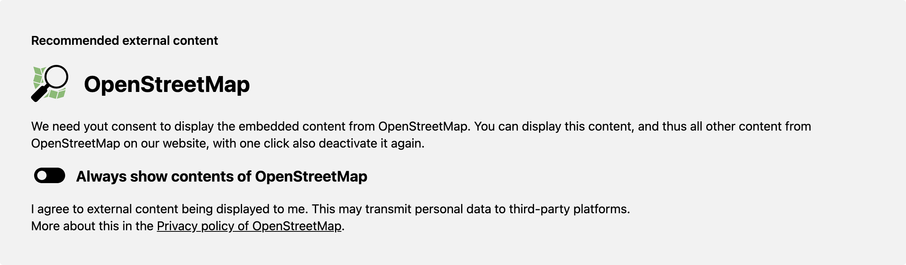

# Kirby 3 Consent Gate - GDPR Compliant External Content Blocker

⚠️ This repository is no longer maintained

This plugin only supports Kirby 3. For newer Kirby versions, please use the updated plugin:

👉 [fendinger/kirby-consent-gate](https://github.com/fendinger/kirby-consent-gate)

No further updates, bug fixes, or security patches will be released for this repository.
Existing Kirby 3 installations will continue to work, but migration to the new plugin is recommended.

## Description

This plugin for [Kirby CMS](https://getkirby.com) blocks the loading of conent from external sources. The content ist only loaded if a consent is accepted (GDPR compliant).

After the user agreed to the loading, he can revoke his decision and the content will be blocked again.

This plugin does not use cookies (GDPR compliant). Instead, the consent is stored in the browsers local storage.

In times of the GPDR it may be important to block external content and use as low cookies as needed.


## Blocks & Tags

The plugin works with these Kirby 3 standard components:

- Block - Image (external source)

- Block - Video (external source)

- Tag - Video (external source)

- Tag - Youtube

- Tag - Vimeo

- Tag - Gist

The plugin adds the following new components to Kirby 3:

- Block - Map

- Block - Twitter Tweet

- Block - Facebook Page

- Tag - Map

  Google maps or openstreetmaps links can be inserted.

  e.g. (map: ...)

- Tag - Twitter Tweet

  Twitter Tweets can be inserted.

  e.g. (twittertweet: ...)

- Tag - Facebook Page

  Facebook Page can be inserted.

  e.g. (facebookpage: ...)


## Features

- GDPR compliant consent before loading external content
- No use of cookies
- The consent is stored in the browsers local storage
- Supports all Kirby 3 standard blocks & tags which can use external content
- Adds new Kirby 3 blocks Map (Google Maps & Openstreetmap), Twitter Tweet & Facebook Page
- Adds new Kirby 3 tags (Google Maps & Openstreetmap), Twitter Tweet & Facebook Page
- In english and german language
- Compatible with Kirby 3




## Installation

```
$ composer require fendinger/kirby3-consent-gate
```

Alternatively, download and copy this repository to `/site/plugins/kirby3-consent-gate`
